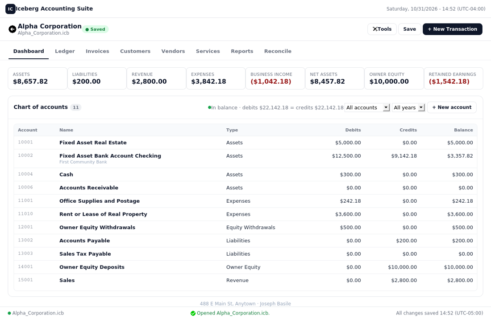
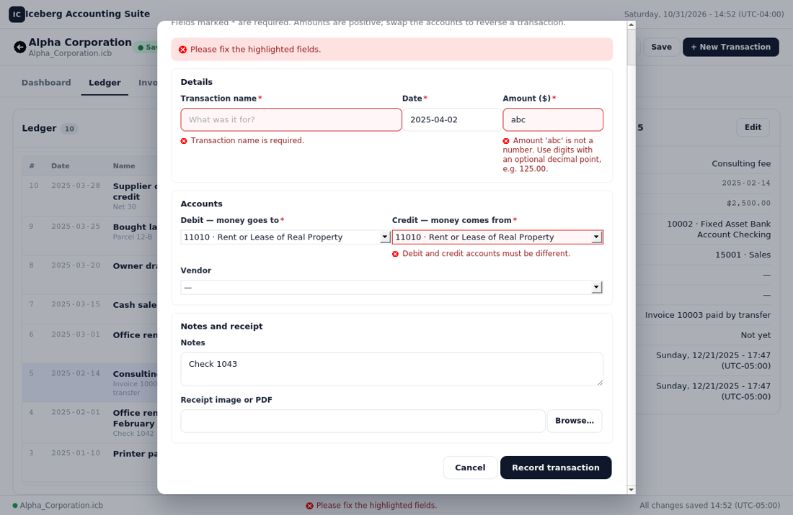
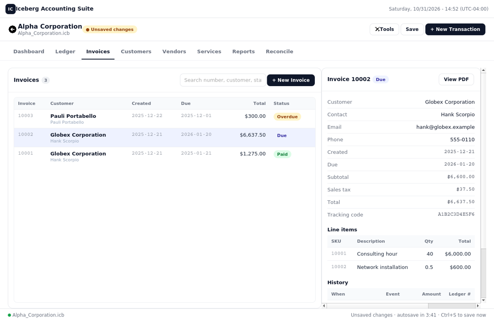

# Iceberg Accounting Suite

Welcome to Iceberg Accounting Suite! Iceberg gives individuals and small businesses a set of
double-entry books with invoicing, reports, and bank reconciliation - all in one encrypted
file on your own computer.

## Installing and starting

**Packaged builds** (no Python needed) are on the releases page: a Windows installer /
portable zip and a Linux archive with `install.sh`, each with SHA-256 checksums. Install,
upgrade, rollback, and uninstall steps are in [docs/DEPLOYMENT.md](docs/DEPLOYMENT.md).
Installed builds keep your books in a per-user data folder (*Tools → Where are my files*).

**From source**, Iceberg runs on **Python 3.11, 3.12, 3.13, or 3.14** on Windows 10/11 and
current Linux distributions. Every dependency installs from prebuilt wheels; no compiler is needed.

**Windows (PowerShell in the Iceberg folder):**

    py -3.13 -m venv .venv          # or py -3.14
    .\.venv\Scripts\Activate.ps1
    python -m pip install -r requirements.txt
    python webapp.py

**Linux:**

    sudo apt install python3-venv gir1.2-webkit2-4.1 python3-gi   # Debian/Ubuntu
    python3 -m venv .venv
    source .venv/bin/activate
    pip install -r requirements.txt
    python webapp.py

On later starts, activate the environment and run `python webapp.py` (add `--browser` to use
your web browser instead of a native window). The full walkthrough,
the platform matrix, and a troubleshooting table are in [docs/SETUP.md](docs/SETUP.md).
Iceberg checks its requirements on every start and explains anything missing in plain
language instead of a traceback; `python startup_checks.py` runs the same checks on demand.

## Finding your way around

- **Welcome** - create a database or open one with its filekey; a link lists the databases
  already in the Iceberg folder.
- **Navigation tabs** - Dashboard, Ledger, Invoices, Customers, Vendors, Services, Reports,
  Reconcile. `Ctrl+1` … `Ctrl+8` switch between them.
- **Tools** (top right, `Ctrl+M`) - database properties, restore from backup, CSV
  import/export, preferences, keyboard shortcuts, the console log, and documentation.
- **Status line** (bottom) - which database is open, the result of your last action, and
  the save state ("All changes saved 14:52" or "Unsaved changes · autosave in 3:41").
- Click any column heading to sort; type in a search box to filter as you type; press
  `Enter` to submit a form and `Esc` to close a dialog.

The complete list of shortcuts and screen-by-screen notes are in
[docs/UI_GUIDE.md](docs/UI_GUIDE.md).

## Databases

### Creating a database
Select **Create New Database** on the Welcome screen.

- Enter the business name (it also becomes the database file name) and address.
- Choose a **filekey folder**. The filekey (`.icbkey`) is the key to your books - keep it
  somewhere safe, such as a thumb drive or a backed-up folder. Without it the database
  cannot be opened.
- Choose a **receipts folder**; receipt images and invoice PDFs are saved there.
- Enter your sales tax percentage (for example `6.25`), or leave `0.00` if you do not
  collect sales tax.
- Select **Create Database**. The form is checked first; any problem is shown next to the
  field. The encrypted database (`.icb`) is written to the Iceberg folder and the dashboard
  opens.

### Opening a database
Select **Open Database…** and pick the filekey (`.icbkey`). Iceberg opens the matching
`.icb` from the Iceberg folder. A wrong key, a missing file, or a damaged file is reported
in the status line and nothing is changed on disk.

### Saving, autosave, and backups
Changes are kept in memory and written to the encrypted file when you save (**Save** or
`Ctrl+S`), automatically every five minutes while there are unsaved changes, and when you
close the window. Every save is atomic (the previous file can never be left half-written)
and writes a timestamped backup to `backups/<Business>/`. The 20 newest backups are kept.
**Tools → Restore from backup** rolls back to any of them, preserving the current file as a
new backup first. See [docs/BACKUP_AND_RESTORE.md](docs/BACKUP_AND_RESTORE.md).

### Database properties
**Tools → Database properties** edits the business details printed on invoices, the
receipts folder, and the sales tax rate.

## Dashboard
Headline figures (assets, liabilities, revenue, expenses, business income, net assets,
owner equity, retained earnings), the balance check, and the chart of accounts filtered by
type and year. Permanent accounts (assets, liabilities, equity) accumulate all history
through the selected year; temporary accounts (revenue, expenses, withdrawals) show the
selected year only.

- Click an account to open its **register** with a running balance; from there you can
  edit the account's details or reconcile it.
- **+ New account** adds an account; its number is assigned from the type's block.

## Ledger
Every transaction, newest first, with search-as-you-type and a year filter. Select a
row to see its details; **Edit** changes it.

**+ New Transaction** (`Ctrl+N`) records a journal entry: name, date, amount, the debit
account (where the money goes) and credit account (where it comes from), an optional
vendor, notes, and a receipt image or PDF. The entry is validated before it is written -
required fields, a real date, a positive amount, existing and distinct accounts - and a
probable duplicate (same name, date, amount, and accounts) asks for confirmation.

## Invoices
Add at least one customer and one service first. **+ New Invoice** (`Ctrl+I`) lets you pick
the customer, add up to ten line items (service × quantity), set the status and due date,
and, for an invoice that is already paid, the deposit account. Totals and sales tax update
as you go. Creating the invoice posts the ledger entries (Accounts Receivable or the deposit
account against Sales and Sales Tax Payable), records the first history event, and saves a
printable PDF in `<receipts>/Invoices/<number>/`.

Select an invoice to see its line items and **history** - every status change, payment,
and refund with the ledger entry numbers it created. Change the status with the form under
the history: Due → Overdue/Paid/Canceled, Overdue → Paid/Canceled, Paid → Refunded.
Paid and Refunded ask for the deposit or refund account. Impossible changes are refused
with an explanation ("A paid invoice cannot be canceled; refund it instead."). **View PDF**
opens the printable invoice.

## Customers, vendors, services
Each workspace has a searchable list, a details panel, and **New**/**Edit** forms with
inline validation. Customers show their outstanding balance and invoices. Vendors can be
attached to transactions. Services are the line items on invoices (description, price,
taxable or not).

## Reports
Income Statement, Income Statement by Month, Balance Sheet, and Statement of Cash Flows for
a preset period (this year, year to date, last year, this/last quarter, this/last month,
all time) or custom dates, with CSV export. See [docs/REPORTS.md](docs/REPORTS.md).

## Reconciliation
Reconcile a bank, cash, or credit-card account against its statement: enter the statement
date and ending balance, load the transactions, tick each one that appears on the
statement, and finish when the difference is zero. History and undo are one click away.
See [docs/RECONCILIATION.md](docs/RECONCILIATION.md).

## Import and export
**Tools → Import transactions from CSV** checks every line before anything is written;
**Export ledger** and **Export all data** produce CSV files for your accountant. Formats
and a sample file: [docs/IMPORT_EXPORT.md](docs/IMPORT_EXPORT.md).

## Preferences
**Tools → Preferences** (`Ctrl+,`): light, dark, or high-contrast appearance; five text
sizes; compact rows. Changes apply immediately.

## Time zones
Every timestamp is stored in UTC and shown in your local time with its offset, e.g.
`Sunday, 12/21/2025  -  17:52 (UTC-05:00)`, so records from different machines and either
side of a daylight-saving change stay consistent.

## Building and releasing

    ./compile.s            # Linux/macOS: venv + dependencies + PyInstaller build + verify + package
    .\build.ps1            # Windows (adds an installer when Inno Setup is installed)

Artifacts land in `release/` with `RELEASE_NOTES.md` (from `CHANGELOG.md`) and
`SHA256SUMS-<platform>.txt`. Pushing a `v<version>` tag runs the same steps on Windows and
Linux in CI and publishes the GitHub release; `python site/build.py --check` builds the
website and `scripts/publish_release_info.py` records checksums on its downloads page.

## For developers

    pytest                              # Python tests (API, accounting, persistence)
    node --test web/tools/render.test.js web/tools/client.test.js   # view and API-client tests
    python scripts/check_release.py     # everything CI runs; add --wheels to verify dependency wheels
    ./compile.s                         # PyInstaller build (dist/iceberg/)

Open `web/index.html` in a browser to preview the interface with sample data. The code
layout is described in [docs/ARCHITECTURE.md](docs/ARCHITECTURE.md); the front-end in
[docs/WEB_INTERFACE.md](docs/WEB_INTERFACE.md).
