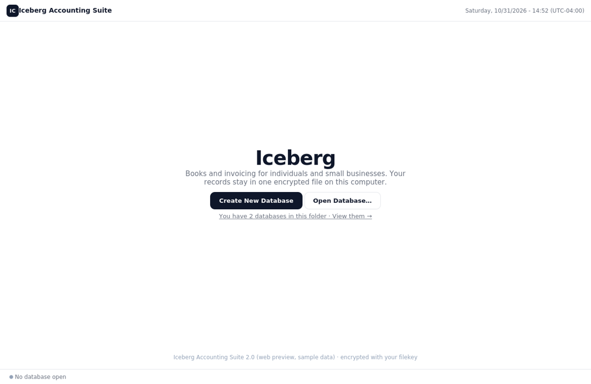
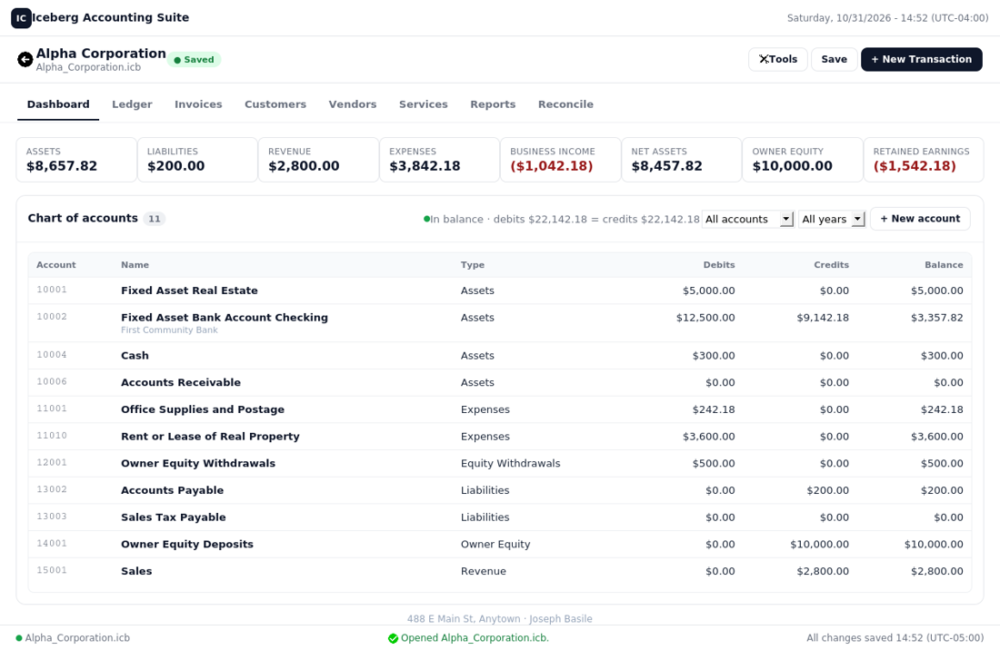
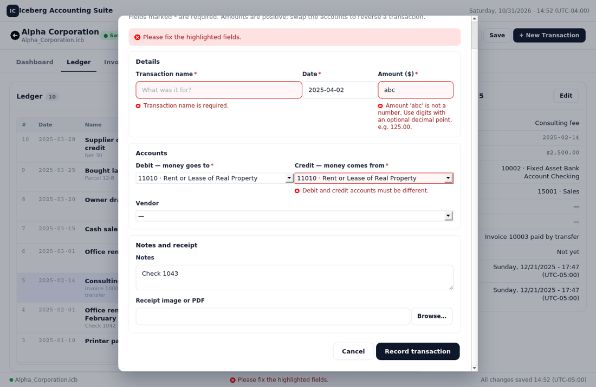
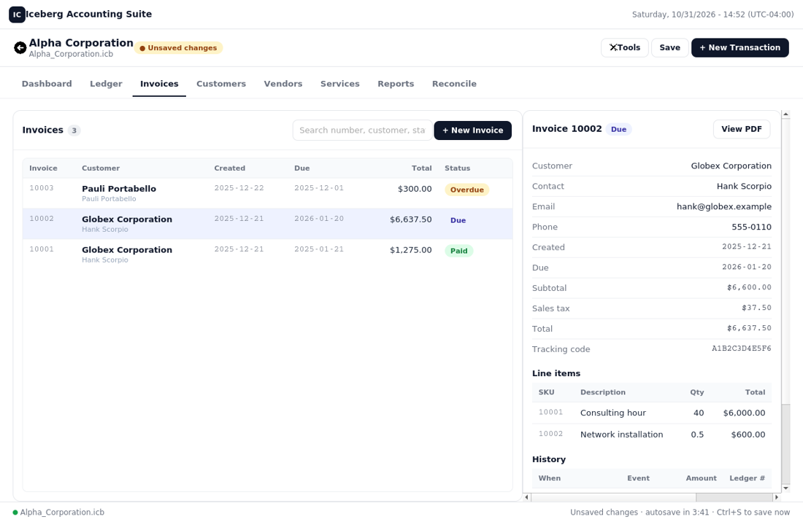
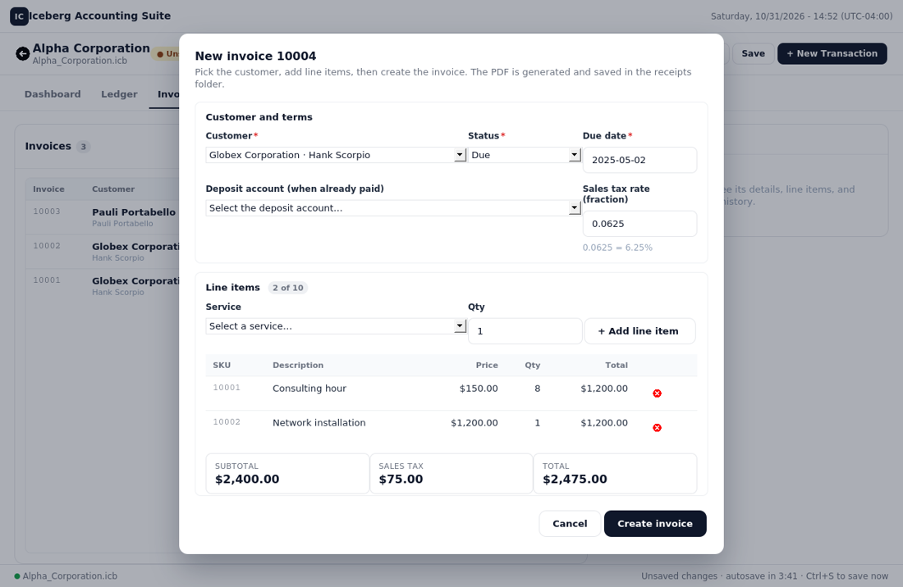
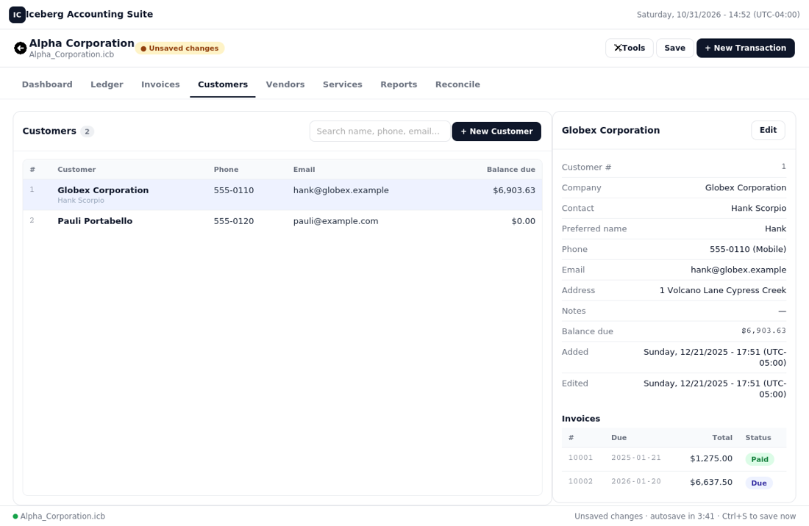
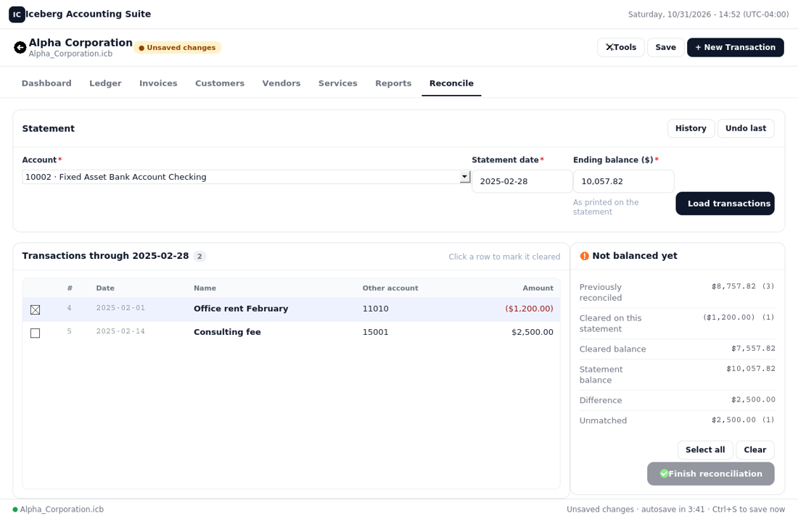
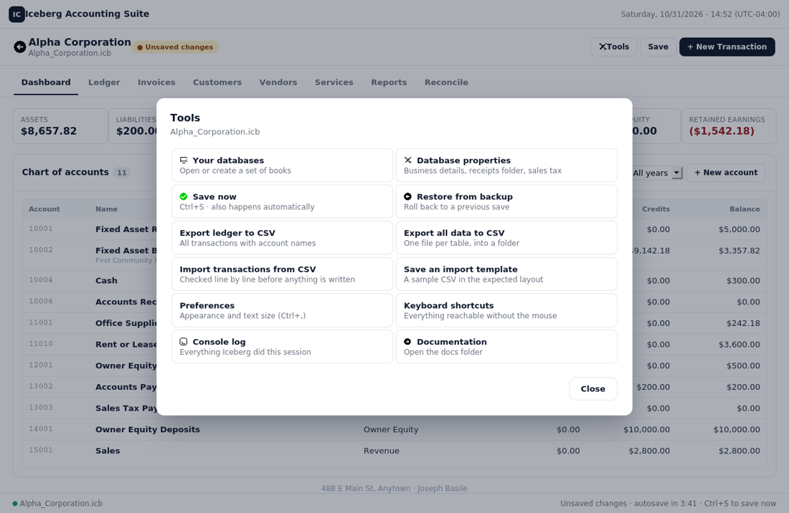

# The Interface: how it is built

Iceberg's window is a native webview (pywebview) that loads the interface from a local
HTTP server. The front-end is plain HTML/CSS/JavaScript; every read and write goes through
one API layer with a single route table shared by both sides. The design follows the practicum
wireframe: white surfaces with hairline borders, rounded cards and panels, a near-black
primary button, pill status badges, compact tables, and a bottom status bar.

```
webapp.py            host: starts the server, opens the native window (or --browser), native file dialogs (DesktopApi)
server.py            local HTTP JSON server: serves web/, dispatches /api/... to IcebergApi per routes.js; session token; lock
api.py               IcebergApi: every operation as JSON in / JSON out; @operation guards; never raises
books.py             schema, default accounts, create/open, dashboard and ledger queries
records.py           accounts, vendors, customers, services (parameterised SQL)
invoices.py          totals, storage, PDF rendering
web/index.html       shell: title bar, content area, status bar, modal overlay
web/routes.js        THE route table: "group.name": [method, path, python handler, [params]]
web/client.js        Api.group.name(args) built from the route table; HttpTransport or MockTransport
web/app.css          design tokens and components; dark / high-contrast themes
web/icons/           the design's icon sheet sliced into transparent PNGs (R.icon(name) renders them)
web/render.js        core views: welcome, databases, create, workspace shell, dashboard, ledger, register, reports
web/render_records.js invoices, customers, vendors, services (+ their dialogs)
web/render_tools.js  reconcile, properties, account dialog, tools menu, backups, import/export, preferences, console
web/app.js           state, declarative screens (load + view), actions, keyboard shortcuts
web/mock.js          sample-data implementation of every handler for browser preview, tests, screenshots
web/tools/           render.test.js, client.test.js (node --test), e2e.js (real client vs real server), snapshot.js
```

## How a request flows

```
screen action  ->  Api.transactions.create({fields})        (app.js, named arguments)
               ->  routes.js: ["POST", "/api/transactions", "add_transaction", ["fields", "confirm_warnings"]]
               ->  HttpTransport: POST /api/transactions  {"fields": {...}}  + X-Iceberg-Token
               ->  server.py: match route, build kwargs, lock, IcebergApi.add_transaction(fields=...)
               ->  api.py: @operation (database open? exceptions -> message), validation, books.add_transaction
               <-  {"ok": true, "message": "Transaction 7 'Rent' recorded.", "id": 7}
```

In a plain browser (no token in the URL) the same `Api` object is built over `MockTransport`,
which calls the matching function in `mock.js` with the parameters in route order.

## Contracts

- **API responses** are `{"ok": bool, "message": str, "errors": [{"field", "message"}], ...}`.
  Field names match the `name` attributes in the forms, so errors land next to the right
  control. Money crosses the API in cents; the front-end formats it.
- **Views are pure**: `render*.js` turn data into HTML strings and never touch the DOM or
  the API, which is why they run in Node for tests and screenshots.
- **Actions** are declared with `data-action="..."` attributes; `app.js` maps each to a
  handler. Tests assert: every emitted action has a handler; every `Api.*` call in `app.js`
  is in the route table; every route names an existing `IcebergApi` method with matching
  parameters; every handler exists in `mock.js`; every public API method has a route.
- **Transport safety**: the server binds to 127.0.0.1 on a random port, requires the
  per-session token on every API call, serialises calls with a lock, and never returns a
  traceback. `app.js` contains no `fetch` and no bridge calls.
- **Preferences** are applied as a class on `<body>` (`theme-dark`, `theme-high-contrast`,
  `compact`) and a root font-size scale.

## Previewing and testing

- Open `web/index.html` in a browser: `mock.js` supplies sample data for every screen.
- `node --test web/tools/render.test.js web/tools/client.test.js` - views, client, consistency checks.
- `tests/test_server.py` - HTTP server (auth, routing, errors), an end-to-end run of the
  real JavaScript client against the real server and database (`web/tools/e2e.js`), and -
  when `jsdom` is installed (`npm install jsdom`) - the shipped `index.html` booted in a
  simulated browser against the live server (`web/tools/page.test.js`), which is the test
  that catches a blank landing page.
- `node web/tools/snapshot.js` writes `build/screens/*.html`; rasterise with any browser
  or `wkhtmltoimage` to refresh `docs/screens/`.
- `pytest tests/test_api.py tests/test_api_records.py tests/test_webapp.py` - the Python
  API against real encrypted databases.

## Screens









